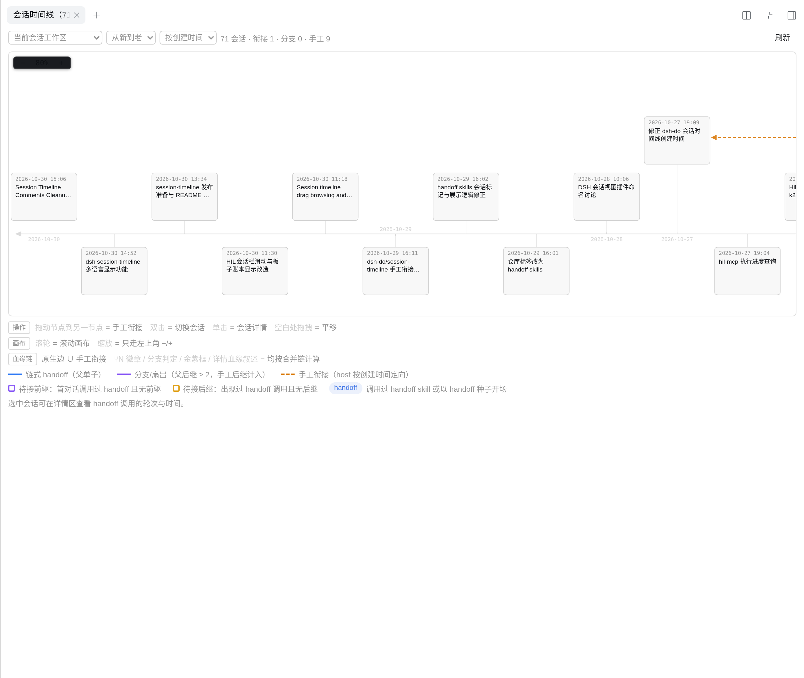
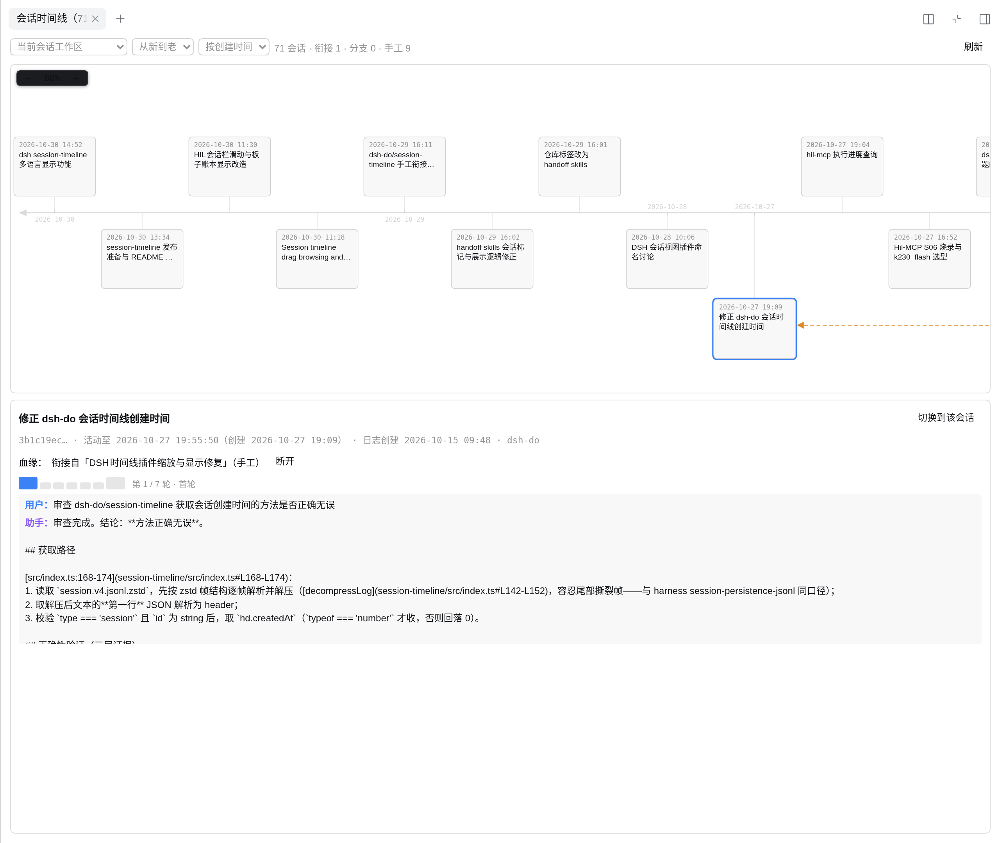

# dsh-session-timeline

English | [中文](README.md)

A DSH (DeepSeek Harness) plugin that adds a **Session Timeline** tab to the right sidebar, drawing every session in a workspace onto a fishbone timeline — native handoff lineage, manual drag links, and branch fan-outs in one picture. Double-click any node to jump straight to that session.



## Features

| Capability | Description |
|---|---|
| Fishbone timeline | Central horizontal spine with date ticks; session nodes alternate above/below, each on a rib |
| Lineage visualization | Blue solid = handoff chain (single child), purple solid = branch fan-out (parent shows a `⑂N` badge), dashed orange = manual link |
| Manual links | Drag between nodes to record "this session continued from that one"; semantics merge with native lineage |
| Handoff hints | Purple frame = used the handoff skill, no predecessor (awaiting one); gold frame = any handoff invocation, no successor (awaiting one) |
| Archived sessions | Header display switch: **show all sessions** (default; archived boxes dashed with an "Archived" tag) / **hide archived sessions** |
| Detail pane + turn strip | Click a node for details; a strip of turn bars pages through the full conversation with handoff turns highlighted in gold |
| Workspace switch | Header dropdown switches session buckets; the current session's workspace shows by name; "All workspaces" draws every workspace onto one canvas (one timeline per workspace on a shared scale, nodes carry their workspace tag); tab shows the live top-level session count |
| One-click jump | Double-click a node (or the detail button) to open that session, across workspaces |
| UI language | Follows the language configured in DSH (中文 / English / 日本語 / Español / Français / Deutsch / Русский / Português), switching live |

## Installation

Prerequisite: DSH (DeepSeek Harness) installed and running.

Open the DSH **Plugins page → Add plugin**, then use any of:

1. **npm package name** (**not published yet**: `@dsh-external/session-timeline` currently returns 404 on the public npm registry; enter the version spec once it ships — see [Distribution](#distribution))
2. **Release tarball** (works today): download the `.tgz` from [GitHub Releases](https://github.com/columforge/dsh-session-timeline/releases), extract it, and enter the extracted directory as a **local path**
3. **Build from source** (developers):

```bash
git clone https://github.com/columforge/dsh-session-timeline.git
cd dsh-session-timeline
npm run build        # needs DSH_CHECKOUT pointing at a DSH source checkout (see below)
```

Then enter this directory as the local path in "Add plugin".

## DSH version support

Installation constraints: `package.json` declares `engines.dsh = ">=0.1.3-alpha.1 <2.0.0"` (the DSH plugin manager rejects a mismatched runtime at install/activation; the lower bound is the oldest DSH that can read v4 session logs) plus the peerDependencies (`@deepseek-ai/dsh-host-webserver` / `@deepseek-ai/dsh-client-ui-slots` `>=0.0.1-rc <2`, `cordis` `>=4.0.0-rc <5`). The correspondence between DSH versions and **session-timeline versions** is the table below:

| DSH version | session-timeline version | Fork lineage detection |
|---|---|---|
| `≥ v0.2.2-alpha.2` (incl. current master) | **`≥ 0.0.32`** | inference only — upstream b096659245 stopped writing `parentSession` for ordinary forks ("ordinary forks independent of source lineage"; upstream upgrade guide at `docs/upgrade-guide/v0.2.1-rc.3/independent-session-forks`, that directory name predates the first shipping tag and is not a version marker). **Plugin ≤ 0.0.31 shows no fork lineage in this range** (that combination is exactly the "native branch not recognized" regression — upgrading the plugin restores it, no data migration needed) |
| `v0.1.7-alpha.1` ≤ X `< v0.2.2-alpha.2` | `≥ 0.0.18` | both paths in parallel: header `parentSession` + inherited-prefix inference (inference available from plugin 0.0.32; earlier plugins with the header path alone already cover forks in this range), backing each other up |
| `v0.1.3-alpha.1` ≤ X `< v0.1.7-alpha.1` | `≥ 0.0.18` | header `parentSession` path only (parent pointers written since DSH `v0.1.2-alpha.1`); the fork seed's `inherited:true` marker does not exist yet, so 0.0.32+ inference never triggers here and behavior equals the header path |
| `< v0.1.3-alpha.1` | — (no plugin version usable) | ❌ unsupported: pre-v4 formats, no `session.v4.jsonl.zstd`; those sessions cannot be read and do not appear |

- **Plugin version scheme**: `0.0.18` = first timeline release (native lineage via header + handoff criteria); `0.0.18 ~ 0.0.31` share the same lineage behavior (UI/geometry iterations in between; public release records 0.0.27 ~ 0.0.31); `0.0.32` = fork inherited-prefix inference release (current version in this repository; distribution channels follow once 0.0.32 ships).
- **Upgrade rule**: when DSH moves to `≥ v0.2.2-alpha.2`, upgrade the plugin to `≥ 0.0.32` (source builds/hot reload take effect immediately); across the other ranges the plugin is backward compatible and never needs downgrading.
- Inference is read-only over session logs: inherited-prefix `(type,seq,time)` signature matching + earliest log `createdAt` tie-break; no match means no edge, never an invented one.
- All other per-session features (creation time, handoff criteria, archive stamping) behave identically across the v4-readable range — no version forks.
- Development/verification baseline: DSH master `8bd073392e` (2026-11-04, `≥ v0.2.2-alpha.2` behavior) + plugin `0.0.32`; 59 tests plus a live reconciliation on the columnas workspace passed.

## Usage

### Time semantics

- **Timeline position / axis ticks / node time = last activity time** (`lastAt`)
- **Creation time = time of the first real user message** (shown in the detail pane only); when the two differ, the pane marks "log created" to flag shell sessions opened long before real use

### Canvas interaction

- **Zoom**: the `− N% +` control, top-left (±10% steps, 10%–300%, anchored at the viewport center; click N% to reset to 100%)
- **Wheel**: native browser scrolling (vertical/horizontal); Ctrl+wheel stays the browser zoom — the panel never hijacks it
- **Pan**: drag on empty canvas (grab → grabbing); dragging on a node creates a manual link

### All workspaces on one canvas

- The workspace dropdown gains "**All workspaces**": one fishbone lane per workspace, stacked vertically; all lanes share ONE horizontal scale — the same column maps to the same x in every lane, and vertical date gridlines align across lanes for cross-workspace comparison
- Lane order follows the current sort/direction (by default the lane with the newest session sits on top); each lane is labeled with its workspace name + session count, and node cards still carry the workspace tag
- Lineage (native handoff/branch, manual links) never crosses workspaces; edges route within their own lane; in the all-workspaces view a manual drag only links two sessions of the same workspace — cross-workspace pairs are rejected with a localized error (`crossWorkspace`)
- **Lane collapse**: click a lane name (`▸`/`▾` prefix) to collapse/expand it; a collapsed lane is a slim label-only band and its sessions stay out of the shared scale
- **Lane filter**: the header "Lane filter" picker checks which workspaces to show (all / none / only the current workspace); hidden lanes drop off the canvas and the tab-title count entirely
- Tab-title count and header stats follow the current view (single workspace / all)

### Ordering and direction

- Sort key dropdown: **by creation time (default) / by last activity**
- Direction: **newest-first (default) / oldest-first**; newest-first puts the spine arrow on the left

### Archived sessions

- Header dropdown: **show all sessions (default) / hide archived sessions**; archive state comes from the workspace registry's global archive set (what the DSH sidebar "archive" action writes)
- Show-all mode draws archived session boxes with **dashed borders** plus an "Archived" tag and marks them in the detail pane; hide mode removes them from the timeline (edges touching them drop out too)
- Header stats append an archived count when present; the tab-title count follows the selected mode

### Lineage chains

- **Nodes** = top-level sessions of the workspace (`session-` prefix; subagent sessions excluded)
- **Independent sessions** sit on the fishbone layer; **handoff chain descendants** stack outward in lineage depth rows, branch children fan out beside their parent
- Edges use **orthogonal obstacle-avoiding routing** (A* with congestion cost to spread parallel wires) — never diagonal, never through a node box
- **Lineage = native edges ∪ manual edges**: in/out degrees, `⑂N` badges, branch detection, and detail-pane narrative all compute over the merged chain — a native single-child edge also renders as a purple branch once you add a manual successor
- **Native fork lineage inference**: since DSH v0.2.2-alpha.2 ordinary forks no longer write `parentSession` (upstream "ordinary forks independent of source lineage" decision, commit b096659245; `v0.2.1-rc.5` and earlier still wrote it), so the timeline recovers lineage from the fork's durable physical trace — the child's last `session/end-seed` event (`inherited:true`) marks the inherited prefix length, which is prefix-signature-matched (`(type,seq,time)` tuples) against the workspace's other top-level sessions; on multiple hits the earliest log `createdAt` wins. No match (source deleted / cross-workspace) means no edge and no invention — the detail pane notes "native fork (lineage inferred from the inherited prefix)". A fork child's creation time uses only its own first user message (inherited prefix skipped); handoff criteria likewise count own invocations only
- The "handoff" tag means the session **actually invoked the handoff skill** or was seeded from one (no text matching)
- Manual entries carry an inline "unlink" button; changes apply immediately

### Detail pane



- Selected node shows: title, creation/last-activity times, lineage narrative, link list
- **Turn strip**: one bar per turn (first/last turns larger, handoff turns gold); click to read the full turn (user message + assistant reply, each truncated to 4000 chars); wheel on the detail frame = previous/next turn
- A "switch to this session" button jumps straight in

## Data and privacy

- **Read-only** scan of `~/.dsh/sessions/<bucket>/<sessionId>/session.v4.jsonl.zstd` (header, title, first-user-message time, last-event time, handoff invocation details; zstd multi-frame decode with mtime/size caching, per-event `(type,seq,time)` signatures for fork lineage inference; zstd multi-frame decode + mtime/size caching, signature cache filled only for buckets holding fork children)
- Archive state is **read-only** too: the workspace registry's archive set (service mirror, falling back to `~/.dsh/storages/workspace.json` `global.archivedSessionIds`)
- **The only write**: manual links go to `~/.dsh/session-timeline/<bucket>.json` (isolated per workspace)
- Nothing is uploaded; session storage is never modified

## API (webserver prefix `/session-timeline/api`)

| Endpoint | Description |
|---|---|
| `GET /workspaces` | Workspace list `{ ok, workspaces: [{bucket, cwd, sessions, newest}] }` |
| `GET /list?workspace=<bucket\|__global__>&session=<id>` | Nodes (+ `archived` flag) + native edges + manual links |
| `GET /turns?session=<id>&workspace=<bucket>&turn=N` | Turn details (`&turn=N` fetches a single turn) |
| `POST /link` `{workspace?, session?, from, to}` | Create a manual link (direction normalized by creation time, idempotent); with `workspace=__global__` each endpoint resolves back to its own bucket — cross-workspace pairs fail with `crossWorkspace` |
| `POST /unlink` `{workspace?, session?, from, to}` | Remove a manual link (matched both ways); with `workspace=__global__` the link's own bucket is resolved from the endpoints |

Error responses carry `{ ok: false, error, code, params? }`: `error` keeps the Chinese text (old clients/logs), while `code` is a stable machine id the UI translates into the configured language (e.g. `workspaceMissing`, `nativeHandoff`, `storageWrite`). `/turns` entries add `userClipped` / `assistantClipped` / `assistantReasoning` flags; the clip/reasoning markers render client-side in that language.

## Development

```bash
npm run build    # tsc host + tsdown client (uses the DSH checkout toolchain)
npm test         # pretest builds, then runs all unit tests
```

- `src/index.ts`: host — bucket scanning + API routes
- `src/parse.ts`: pure session-log parsing (no plugin dependencies)
- `src/geometry/layout.ts`: pure layout (metrics and coordinates)
- `src/geometry/lineage.ts`: pure merged-lineage semantics
- `src/geometry/routing.ts`: pure orthogonal obstacle-avoiding routing
- `src/client/index.ts`: UI — components, dragging, details, rendering
- `test/*.test.mjs`: unit tests (node:test, importing the built `lib/`)

The build borrows tsc/tsdown from a DSH source checkout: `export DSH_CHECKOUT=<dsh source dir>` (build.sh auto-probes `~/dsh-harness` and other common paths).

When touching the A*/layout geometry, read the "three historical pitfalls" comment atop `src/geometry/*.ts` first; verify with `npm test` before browser DOM sampling (SVG path V/H are single-coordinate commands — parsing them as x,y pairs gives false alarms).

## Distribution

- **GitHub Releases**: every version ships an `npm pack` tgz (with the built `lib/`, extract and install) — **the only distribution channel today**
- **npm** (not published): the public registry still returns 404 for this package; all peer dependencies are on public npm, so publishing is ready to go, and README plus market index switch once it ships
- **Plugin market index**: `market-index.json` is a format-1 index (versions, install source, `engines.dsh` minimum DSH version); before npm publication its npm-sourced entries are not installable and serve as a version catalog only. Add this repo's raw URL in the DSH Discover tab to browse

## License

[BSD-3-Clause](LICENSE)
