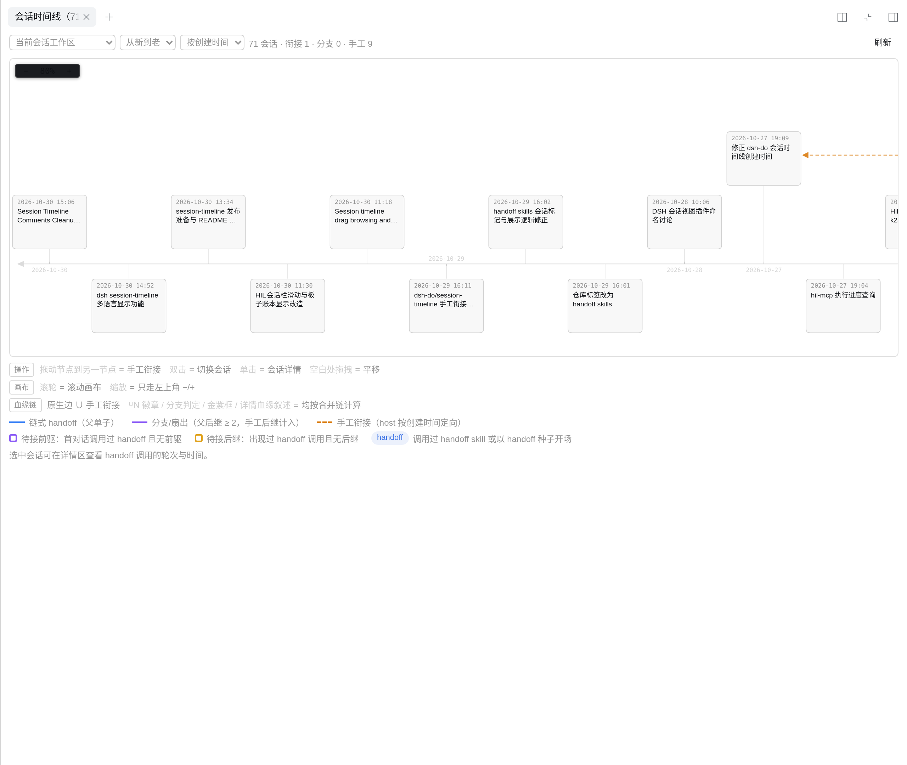
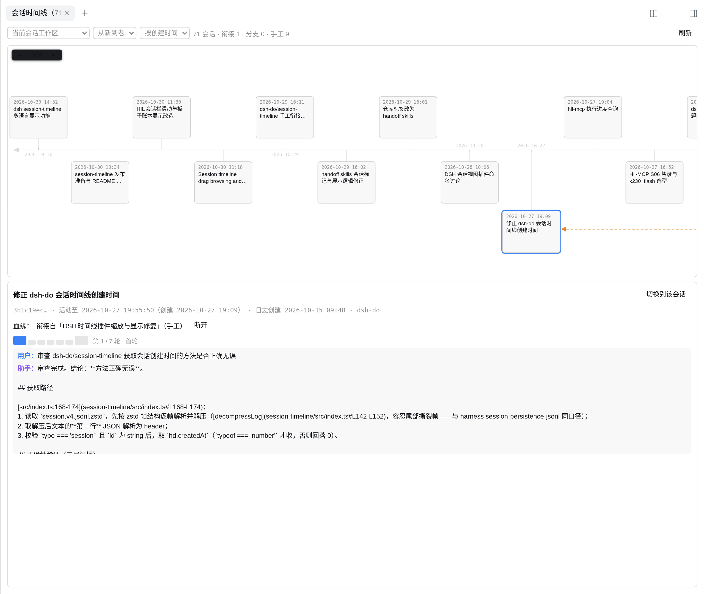

# dsh-session-timeline

[English](README.en.md) | 中文

DSH（DeepSeek Harness）插件：在右侧边栏新增**「会话时间线」**页签，把一个工作区的全部会话画成一条鱼骨时间线——原生 handoff 血缘、手工拖拽衔接、分支扇出一图全览，双击即达任意历史会话。



## 功能一览

| 能力 | 说明 |
|---|---|
| 鱼骨时间线 | 中央水平主轴 + 日期刻度，会话节点在轴上下交替排布，鱼刺连轴 |
| 血缘可视化 | 蓝实线 = handoff 衔接（父单子），紫实线 = 分支（扇出，父带 `⑂N` 徽章），虚线橙 = 手工衔接 |
| 手工衔接 | 节点间拖拽即可补记「这个会话接着那个会话」，与原生血缘合并计算语义 |
| handoff 待接提示 | 紫框 = 调用过 handoff skill 且无前驱（待接前驱）；金框 = 出现过 handoff 调用且无后继（待接后继） |
| 归档会话显示 | 头部切换「**显示全部会话**（默认，归档框虚线 + 归档标签）/ **隐藏归档会话**」，归档状态来自工作区注册表归档集 |
| 详情区 + 轮次条 | 点击节点查看会话详情；一排轮次横条翻看完整对话，handoff 调用轮金色高亮 |
| 工作区切换 | 顶部下拉切换会话桶，当前会话所在工作区直接以名称显示；「所有工作区」把全部工作区画进同一张画布（每工作区一根时间线，刻度一致，节点标注所属工作区）；页签计数实时显示顶层会话数 |
| 一键跳转 | 双击节点（或详情区按钮）直接切换到该会话，跨工作区生效 |
| 界面语言 | 跟随 DSH 设置的语言（中文 / English / 日本語 / Español / Français / Deutsch / Русский / Português）即时切换 |

## 安装
前置：已安装并运行 DSH（DeepSeek Harness ≥ v0.1.3-alpha.1，见 [DSH 版本支持](#dsh-版本支持)）。

**推荐：npm（预构建，安装即用）**：

```bash
dsh plugin --profile web add @columforge/session-timeline
```

或在 DSH 插件页「添加插件」填入包名 `@columforge/session-timeline`。

**备选：市场索引（git 源，不经过 npm）**——在 DSH **插件页 → 发现** 添加索引 URL：

```
https://columforge.github.io/dsh-session-timeline/market-index.json
```

列表中的最新条目为 git 源（钉固定 commit，走 bundle 安装通道）。也可直接命令行安装（`<commit>` 取 `market-index.json` 的 `source.commit`）：

```bash
dsh plugin --profile web add "git+https://github.com/columforge/dsh-session-timeline.git#<commit>"
```

其余方式：

1. **Release 压缩包**：从 [GitHub Releases](https://github.com/columforge/dsh-session-timeline/releases) 下载 `.tgz`，解压后把**解压目录的本地路径**填进「添加插件」
2. **源码构建**（开发者）：

```bash
git clone https://github.com/columforge/dsh-session-timeline.git
cd dsh-session-timeline
npm run build        # 需 DSH_CHECKOUT 指向 DSH 源码 checkout（见下）
```

然后把本目录填入「添加插件」的本地路径。
## DSH 版本支持

安装约束：`package.json` 声明 `engines.dsh = ">=0.1.3-alpha.1 <2.0.0"`（DSH 插件管理器在安装/激活时按此拦截不匹配的运行时，边界语义为"v4 日志可读的最老版本"）与 peerDependencies（`@deepseek-ai/dsh-host-webserver` / `@deepseek-ai/dsh-client-ui-slots` `>=0.0.1-rc <2`、`cordis` `>=4.0.0-rc <5`）。DSH 版本与 **session-timeline 版本**的对应关系按下表：

| DSH 版本 | 对应 session-timeline 版本 | fork 血缘识别 |
|---|---|---|
| `≥ v0.2.2-alpha.2`（含当前 master） | **`≥ 0.0.32`** | 仅推断路径——上游 b096659245 起普通 fork 不再写 `parentSession`（"ordinary forks independent of source lineage"；上游升级指南在 `docs/upgrade-guide/v0.2.1-rc.3/independent-session-forks`，该目录名先于首发 tag，勿当版本判据）。**插件 ≤ 0.0.31 在此区间 fork 不显示血缘**（即「分支识别失效」的根因组合，升级插件即恢复，无需迁移数据） |
| `v0.1.7-alpha.1` ≤ X `< v0.2.2-alpha.2` | `≥ 0.0.18` | 双路径并行：header `parentSession` + 继承前缀推断（推断自插件 0.0.32 起提供；更早插件仅 header，已能覆盖该段 fork），互为兜底 |
| `v0.1.3-alpha.1` ≤ X `< v0.1.7-alpha.1` | `≥ 0.0.18` | 仅 header `parentSession` 路径（父指针自 DSH `v0.1.2-alpha.1` 起写入）；fork 种子的 `inherited:true` 标记尚未存在，0.0.32+ 的推断在此段恒不触发，行为等同 header 路径 |
| `< v0.1.3-alpha.1` | —（任意插件版本均不可用） | ❌ 不支持：无 `session.v4.jsonl.zstd`（v4 之前的格式），该批会话不可读、不入时间线 |

- **插件版本口径**：`0.0.18` = 时间线首版（原生血缘 header 路径 + handoff 判定）；`0.0.18 ~ 0.0.31` 血缘行为一致（其间为界面/几何迭代；公开发布记录 0.0.27 ~ 0.0.31）；`0.0.32` = fork 继承前缀推断版（本仓库当前版本，发布渠道随 0.0.32 上架）。
- **升级口径**：DSH 升至 `≥ v0.2.2-alpha.2` 时，插件须同步升至 `≥ 0.0.32`（源码构建/热重载即刻生效）；其余区间插件向下兼容，旧插件无需降级。
- 推断只读会话日志：按继承前缀 `(type,seq,time)` 签名匹配 + 日志 `createdAt` 次序消歧；匹配不到不出边、不臆造。
- 顶层会话的创建时间等其余功能在 v4 可读区间内行为一致，不随版本分叉。
- 开发/验证基线：DSH master `8bd073392e`（2026-11-04，`≥ v0.2.2-alpha.2` 行为）+ 插件 `0.0.32`；59 项测试与 columnas 工作区线上对账通过。

## 使用指南

### 时间语义

- **时间线定位 / 轴刻度 / 节点框内时间 = 最后活动时间**（`lastAt`）
- **创建时间 = 首条真实用户消息的时间**（仅详情区显示）；两者不同时详情区会标注「日志创建」，用于识别"打开过但很久才开始对话"的空壳会话

### 画布交互

- **缩放**：左上角 `− N% +` 控件（±10%，10%~300%，围绕视口中心锚定；点击 N% 复位 100%）
- **滚轮**：浏览器原生滚动（上下/左右），面板不拦截；Ctrl+滚轮 = 浏览器整体缩放
- **平移**：画布空白处按住左键拖拽（grab → grabbing）；在节点上拖拽 = 建立手工衔接连线

### 所有工作区一画布

- 工作区下拉新增「**所有工作区**」：每个工作区一根鱼骨时间线（泳道）纵向堆叠；全部泳道共用同一套横向刻度——同一列在每根线上的 x 相同，纵向日期网格线跨线对齐，可跨工作区按时间对照
- 泳道顺序跟随当前排序与方向（默认最新会话所在的工作区在顶）；泳道左上角标注工作区名与会话数，节点卡片仍带工作区标签
- 血缘（原生 handoff / 分支、手工衔接）不跨工作区，连线只在各自泳道内走正交避障路由；全局视图下手工拖拽仅对同一工作区的两会话生效，跨工作区拖拽会提示错误（`crossWorkspace`）
- **泳道折叠**：单击泳道名（`▸`/`▾` 前缀）折叠/展开该泳道；折叠后只剩标签细条，其会话暂不占用共享刻度
- **泳道筛选**：头部「泳道筛选」勾选要显示的工作区（全选 / 全不选 / 只看当前工作区）；被隐藏的泳道连同会话一起退出画布与页签计数
- 页签计数与头部统计跟随当前视图（单工作区 / 全部）

### 排序与方向

- 头部下拉切换排序键：**按创建时间（默认）/ 按最后活动**
- 方向：**从新到老（默认）/ 从老到新**；从新到老时主轴箭头在左端

### 归档会话

- 头部下拉切换：**显示全部会话（默认）/ 隐藏归档会话**；归档状态来自工作区注册表的归档集（即 DSH 侧边栏「归档」动作写入的数据）
- 显示全部模式下，归档会话框为**虚线边框** + 「归档」标签，详情区标注「已归档」；隐藏模式下归档会话从时间线移除（触及它们的连线一并消失）
- 头部统计在有归档会话时追加归档数；页签计数跟随所选模式

### 血缘链

- **节点** = 工作区的顶层会话（`session-` 前缀；subagent 会话不入线）
- **独立会话**在鱼骨层（主轴上下交替）；**handoff 链子会话**用血缘深度行向轴外侧叠行，分支子与父同侧扇出
- 连线走**正交避障路由**（A* + 拥挤代价错开平行走线），绝不出斜线、不穿会话框
- **血缘链 = 原生边 ∪ 手工边**：出入度、`⑂N` 徽章、分支判定、详情区叙述全部按合并链计算——父已有原生单子再补一条手工后继时，单子边也显形为紫色分支线
- **原生 fork 血缘推断**：DSH v0.2.2-alpha.2 起普通 fork 不再写入 `parentSession`（上游"普通 fork 与来源血缘解耦"决策，commit b096659245；`v0.2.1-rc.5` 及更早仍在写），时间线改从 fork 的持久物理痕迹恢复血缘——子代日志末位 `session/end-seed`（`inherited:true`）标记继承前缀长度，与同工作区其余顶层会话做前缀签名匹配（`(type,seq,time)` 三元组），命中多条时按日志 `createdAt` 最早者为来源；匹配不到（来源已删/跨工作区）不出边、不臆造，详情区标注「原生 fork（血缘按继承前缀推断）」。fork 子代的创建时间只取自有首条用户消息（跳过继承前缀），handoff 判定同样只数自有调用
- 「handoff」标签 = 会话**实际调用过 handoff skill** 或以 handoff 种子开场（不按消息文字匹配）
- 手工条目自带「断开」按钮，删改即时生效

### 详情区



- 选中节点显示：标题、创建/最后活动时间、血缘叙述、衔接列表
- **轮次条**：每轮一根横条（首/末轮较大，handoff 调用轮金色），点击查看该轮完整对话（用户消息 + 助手回复，各截断 4000 字符）；详情外框滚轮 = 上一轮/下一轮
- 「切换到该会话」按钮一键跳转

## 数据与隐私

- **只读**扫描 `~/.dsh/sessions/<bucket>/<sessionId>/session.v4.jsonl.zstd`（header、标题、首条用户消息时间、末事件时间、handoff 调用明细、fork 血缘推断的逐事件 `(type,seq,time)` 签名；zstd 多帧解码 + mtime/size 缓存，签名缓存仅在有 fork 子代的桶内填充）
- 归档状态同样**只读**：读工作区注册表归档集（服务镜像，兜底 `~/.dsh/storages/workspace.json` 的 `global.archivedSessionIds`）
- **唯一写入**：手工衔接落 `~/.dsh/session-timeline/<bucket>.json`（按工作区隔离）
- 不上传任何数据，不改动会话存储

## API（webserver 前缀路由 `/session-timeline/api`）

| 端点 | 说明 |
|---|---|
| `GET /workspaces` | 工作区清单 `{ ok, workspaces: [{bucket, cwd, sessions, newest}] }` |
| `GET /list?workspace=<桶\|__global__>&session=<id>` | 节点（含 `archived` 标记）+ 原生边 + 手工衔接清单 |
| `GET /turns?session=<id>&workspace=<桶>&turn=N` | 轮次明细（`&turn=N` 单轮按需取） |
| `POST /link` `{workspace?, session?, from, to}` | 建立手工衔接（按创建时间归一定向，幂等）；`workspace=__global__` 时按端点解析回各自工作区，跨工作区对报 `crossWorkspace` |
| `POST /unlink` `{workspace?, session?, from, to}` | 删除手工衔接（双向匹配）；`workspace=__global__` 时按端点解析回所属工作区 |

错误响应统一带 `{ ok: false, error, code, params? }`：`error` 是中文原文（兼容旧客户端/日志），`code` 为稳定机器码，界面按当前语言翻译（如 `workspaceMissing`、`nativeHandoff`、`storageWrite`）。`/turns` 的轮次对象附带 `userClipped` / `assistantClipped` / `assistantReasoning` 标志位，截断与推理标记由前端按语言渲染。

## 开发

```bash
npm run build    # tsc host + tsdown client（借 DSH checkout 工具链）
npm test         # pretest 自动 build，再跑全部单测
```

- `src/index.ts`：host——会话桶扫描 + API 路由
- `src/parse.ts`：纯函数会话日志解析（无插件依赖）
- `src/geometry/layout.ts`：纯函数布局（版面常量与坐标计算）
- `src/geometry/lineage.ts`：纯函数血缘链合并语义
- `src/geometry/routing.ts`：纯函数正交避障路由
- `src/client/index.ts`：UI——组件、拖拽、详情、渲染
- `test/*.test.mjs`：单测（node:test，导入 `lib/` 构建产物）

构建依赖 DSH 源码 checkout 的 tsc/tsdown：`export DSH_CHECKOUT=<dsh 源码目录>`（build.sh 会自动探测 `~/dsh-harness` 等常见路径）。

改 A*/布局几何时先读 `src/geometry/*.ts` 顶部「三个历史坑」注释；验证 = `npm test` 全绿后再浏览器 DOM 采样（SVG path 的 V/H 是单坐标指令，按 x,y 成对解析会误报）。

质量门禁（ub-mode 定向 CRAP + 重复度）：`bash scripts/gate.sh`——范围、工具安装与当前基线见 [docs/gates.md](docs/gates.md)。

## 发布渠道
- **npm（主渠道）**：`@columforge/session-timeline`（公共 npm，预构建安装；`publishConfig.access=public`）。社区目录（如 awesome-dsh-plugin）的 `index.json` 由脚本从 npm 数据生成，npm 上架后即可被收录进 DSH 发现页
- **git 源（备份通道）**：`market-index.json` 的版本条目使用 `source.type: git`，钉在 GitHub 仓库的固定 commit；DSH 以 bundle 方式安装该 commit（`lib/` 已提交，无需构建、无需 npm）
- **GitHub Releases**：每个版本附 `npm pack` 产出的 tgz（解压即装的本地目录形态，也便于离线分发）
- Release 标题/正文与发布流程规则见 [docs/release-notes-style.md](docs/release-notes-style.md)
## 许可证

[BSD-3-Clause](LICENSE)
