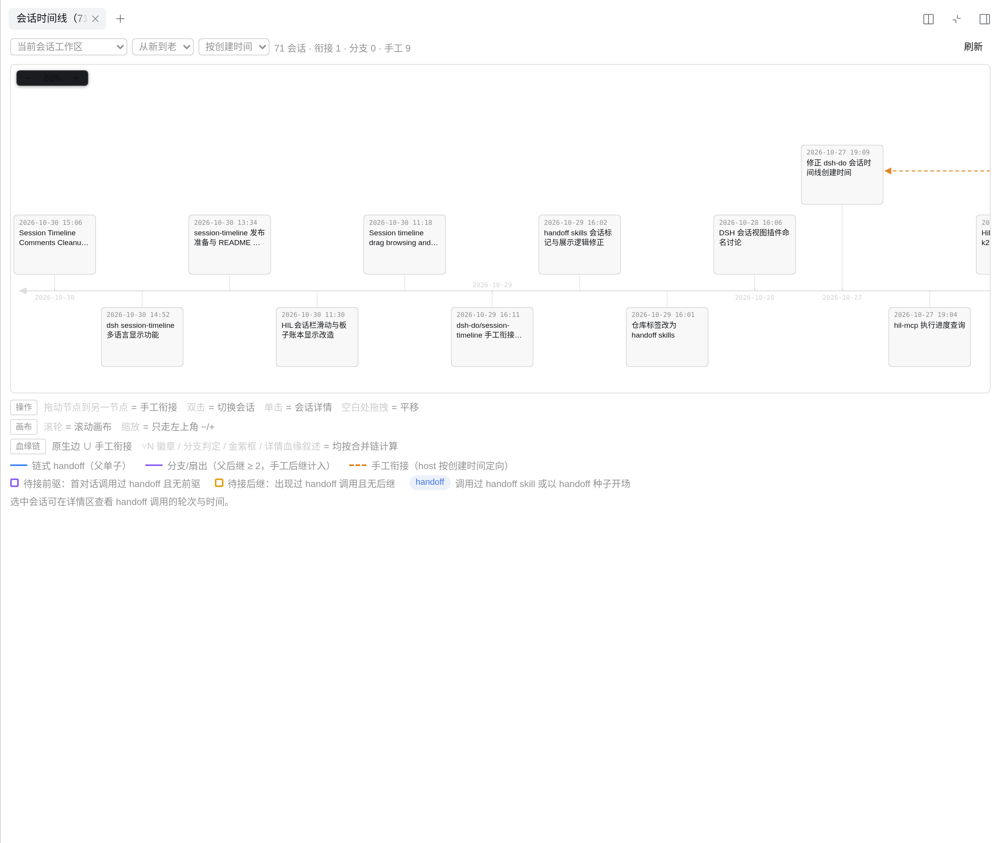
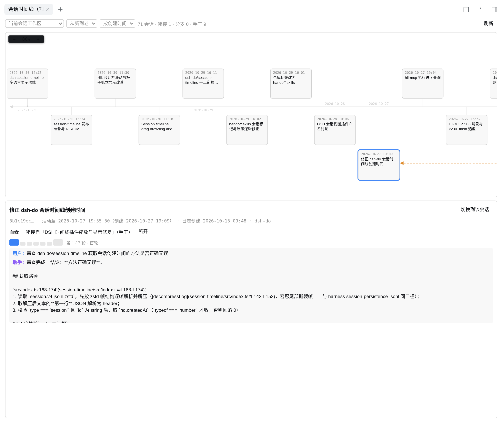

# dsh-session-timeline

[English](README.en.md) | 中文

DSH（DeepSeek Harness）插件：在右侧边栏新增**「会话时间线」**页签，把一个工作区的全部会话画成一条鱼骨时间线——原生 handoff 血缘、手工拖拽衔接、分支扇出一图全览，双击即达任意历史会话。



## 功能一览

| 能力 | 说明 |
|---|---|
| 鱼骨时间线 | 中央水平主轴 + 日期刻度，会话节点在轴上下交替排布，鱼刺连轴 |
| 血缘可视化 | 蓝实线 = handoff 衔接（父单子且子非 fork），紫实线 = 分支（扇出 `⑂N` 徽章，或子为 fork——fork 无论扇出都是分支），虚线橙 = 手工衔接 |
| 手工衔接 | 节点间拖拽即可补记「这个会话接着那个会话」，与原生血缘合并计算语义 |
| handoff 待接提示 | 紫框 = 调用过 handoff skill 且无前驱（待接前驱）；金框 = 出现过 handoff 调用且无后继（待接后继） |
| 归档会话显示 | 头部切换「**显示全部会话**（默认，归档框虚线 + 归档标签）/ **隐藏归档会话**」，归档状态来自工作区注册表归档集 |
| 详情区 + 轮次条 | 点击节点查看会话详情；一排轮次横条翻看完整对话（助手回复与对话区同一 Markdown 渲染），handoff 调用轮金色高亮 |
| 工作区切换 | 顶部下拉切换会话桶，当前会话所在工作区直接以名称显示；「所有工作区」把全部工作区画进同一张画布（每工作区一根时间线，刻度一致，节点标注所属工作区）；页签计数实时显示顶层会话数 |
| 一键跳转 | 双击节点（或详情区按钮）直接切换到该会话，跨工作区生效 |
| 会话内定位 | 详情区「定位」把对话切到该会话并滚动到所选轮次——任意会话可用（当前会话用 turnOutline 投影的 turn/start seq，其余会话用 `/turns` 的用户消息 seq 走官方 `loadThrough`） |
| 界面语言 | 跟随 DSH 设置的语言（中文 / English / 日本語 / Español / Français / Deutsch / Русский / Português）即时切换 |

## 安装
前置：已安装并运行 DSH（DeepSeek Harness ≥ v0.1.3-alpha.1，见 [DSH 版本支持](#dsh-版本支持)）。

**推荐：npm（预构建，安装即用）**：

```bash
dsh plugin --profile web add @columforge/session-timeline
```

或在 DSH 插件页「添加插件」填入包名 `@columforge/session-timeline`。

**备选：市场索引**——在 DSH **插件页 → 发现** 添加索引 URL：

```
https://columforge.github.io/dsh-session-timeline/market-index.json
```

列表中的最新条目即已上架 npm 的版本。git 源是独立的备份通道，命令行直装（`<commit>` 取该版本 tag 指向的提交，如 `v0.1.2`）：

```bash
dsh plugin --profile web add "git+https://github.com/columforge/dsh-session-timeline.git#<commit>"
```

其余方式：

1. **Release 压缩包**：从 [GitHub Releases](https://github.com/columforge/dsh-session-timeline/releases) 下载 `.tgz`，解压后把**解压目录的本地路径**填进「添加插件」
2. **源码构建**（开发者）：

```bash
git clone https://github.com/columforge/dsh-session-timeline.git
cd dsh-session-timeline
npm run build        # 需 DSH_CHECKOUT 指向 DSH 源码 checkout（见下）
```

然后把本目录填入「添加插件」的本地路径。
## DSH 版本支持

安装约束：`package.json` 声明 `engines.dsh = ">=0.1.3-alpha.1 <2.0.0"`（DSH 插件管理器在安装/激活时按此拦截不匹配的运行时，边界语义为"v4 日志可读的最老版本"）与 peerDependencies（`@deepseek-ai/dsh-host-webserver` / `@deepseek-ai/dsh-client-ui-slots` `>=0.0.1-rc <2`、`cordis` `>=4.0.0-rc <5`）。DSH 版本与 **session-timeline 版本**的对应关系按下表：

| DSH 版本 | 对应 session-timeline 版本 | fork 血缘识别 |
|---|---|---|
| `≥ v0.2.3-alpha.2` | **`≥ 0.1.1`** | 仅推断路径（同上）；另须 `≥ 0.1.1` 才能把 fork 边正确显形为**分支**（紫实线）——≤ 0.1.0 把单后继 fork 边误显为 handoff（蓝实线）且 fork 子误打 handoff 标签。已验证存储格式不变（仍 `session.v4.jsonl.zstd`，SQLite 持久化为并存备选、不进该 profile） |
| `≥ v0.2.2-alpha.2`（含当前 master） | **`≥ 0.0.32`** | 仅推断路径——上游 b096659245 起普通 fork 不再写 `parentSession`（"ordinary forks independent of source lineage"；上游升级指南在 `docs/upgrade-guide/v0.2.1-rc.3/independent-session-forks`，该目录名先于首发 tag，勿当版本判据）。**插件 ≤ 0.0.31 在此区间 fork 不显示血缘**（即「分支识别失效」的根因组合，升级插件即恢复，无需迁移数据） |
| `v0.1.7-alpha.1` ≤ X `< v0.2.2-alpha.2` | `≥ 0.0.18` | 双路径并行：header `parentSession` + 继承前缀推断（推断自插件 0.0.32 起提供；更早插件仅 header，已能覆盖该段 fork），互为兜底 |
| `v0.1.3-alpha.1` ≤ X `< v0.1.7-alpha.1` | `≥ 0.0.18` | 仅 header `parentSession` 路径（父指针自 DSH `v0.1.2-alpha.1` 起写入）；fork 种子的 `inherited:true` 标记尚未存在，0.0.32+ 的推断在此段恒不触发，行为等同 header 路径 |
| `< v0.1.3-alpha.1` | —（任意插件版本均不可用） | ❌ 不支持：无 `session.v4.jsonl.zstd`（v4 之前的格式），该批会话不可读、不入时间线 |

- **插件版本口径**：`0.0.18` = 时间线首版（原生血缘 header 路径 + handoff 判定）；`0.0.18 ~ 0.0.31` 血缘行为一致（其间为界面/几何迭代；公开发布记录 0.0.27 ~ 0.0.31）；`0.0.32` = fork 继承前缀推断版；`0.1.0` = turnOutline 集成版（详情区实时轮次刷新、任意会话「定位」跳转、助手回复 Markdown 渲染；发布渠道随 0.1.0 上架）；`0.1.1` = fork 显形修正版（fork 边无论扇出均为分支线、fork/handoff 标签互斥）+ v0.2.3-alpha.2 适配验证；`0.1.2` = 加载策略版（持久索引 + 追加帧增量合并 + 骨架优先，全量构建在 worker thread——主机重启后不再同步全量解析会话日志）。
- **升级口径**：DSH 升至 `≥ v0.2.3-alpha.2` 时，插件须同步升至 `≥ 0.1.1`；DSH 在 `≥ v0.2.2-alpha.2` 区间须 `≥ 0.0.32`（源码构建/热重载即刻生效）；其余区间插件向下兼容，旧插件无需降级。
- 推断只读会话日志：按继承前缀 `(type,seq,time)` 签名匹配 + 日志 `createdAt` 次序消歧；匹配不到不出边、不臆造。
- 顶层会话的创建时间等其余功能在 v4 可读区间内行为一致，不随版本分叉。
- 开发/验证基线：DSH tag `dsh-v0.2.3-alpha.2`（`4b399c39a6`，2026-11-22）+ 插件 `0.1.2`；131 项测试、CRAP/重复度门禁与真实日志差分守卫（1994 会话）通过，raysenchip 工作区线上对账通过（f2b28302→afe7d5b4 fork 边显形为分支）；加载策略改造后 27 条路由新旧响应逐字节相等。

## 使用指南

### 时间语义

- **时间线定位 / 轴刻度 / 节点框内时间 = 最后活动时间**（`lastAt`）
- **创建时间 = 首条真实用户消息的时间**（仅详情区显示）；两者不同时详情区会标注「日志创建」，用于识别"打开过但很久才开始对话"的空壳会话

### 画布交互

- **缩放**：左上角 `− N% +` 控件（±10%，10%~300%，围绕视口中心锚定；点击 N% 复位 100%）
- **滚轮**：浏览器原生滚动（上下/左右），面板不拦截；Ctrl+滚轮 = 浏览器整体缩放
- **平移**：画布空白处按住左键拖拽（grab → grabbing）；在节点上拖拽 = 建立手工衔接连线

### 所有工作区一画布

- 工作区下拉新增「**所有工作区**」：每个工作区一根鱼骨时间线（泳道）纵向堆叠；全部泳道共用同一套横向刻度——同一列在每根线上的 x 相同，纵向日期网格线跨线对齐，可跨工作区按时间对照
- 泳道顺序跟随当前排序与方向（默认最新会话所在的工作区在顶）；泳道左上角标注工作区名与会话数，节点卡片仍带工作区标签
- 血缘（原生 handoff / 分支、手工衔接）不跨工作区，连线只在各自泳道内走正交避障路由；全局视图下手工拖拽仅对同一工作区的两会话生效，跨工作区拖拽会提示错误（`crossWorkspace`）
- **泳道折叠**：单击泳道名（`▸`/`▾` 前缀）折叠/展开该泳道；折叠后只剩标签细条，其会话暂不占用共享刻度
- **泳道筛选**：头部「泳道筛选」勾选要显示的工作区（全选 / 全不选 / 只看当前工作区）；被隐藏的泳道连同会话一起退出画布与页签计数
- 页签计数跟随当前视图（单工作区 / 全部）

### 排序与方向

- 头部下拉切换排序键：**按创建时间（默认）/ 按最后活动**
- 方向：**从新到老（默认）/ 从老到新**；从新到老时主轴箭头在左端

### 归档会话

- 头部下拉切换：**显示全部会话（默认）/ 隐藏归档会话**；归档状态来自工作区注册表的归档集（即 DSH 侧边栏「归档」动作写入的数据）
- 显示全部模式下，归档会话框为**虚线边框**（色键在下方图例）；隐藏模式下归档会话从时间线移除（触及它们的连线一并消失）
- 页签计数跟随所选模式

### 血缘链

- **节点** = 工作区的顶层会话（`session-` 前缀；subagent 会话不入线）
- **独立会话**在鱼骨层（主轴上下交替）；**handoff 链子会话**用血缘深度行向轴外侧叠行，分支子与父同侧扇出
- 连线走**正交避障路由**（A* + 拥挤代价错开平行走线），绝不出斜线、不穿会话框
- **血缘链 = 原生边 ∪ 手工边**：出入度、`⑂N` 徽章、分支判定、详情区箭头行全部按合并链计算——父已有原生单子再补一条手工后继时，单子边也显形为紫色分支线
- **边类别按子的物理血统判定（0.1.1 起）**：fork 子（own `inherited:true` end-seed 标记）的边一律为**分支**——紫实线，即使父只有这一个后继；handoff 蓝实线仅保留给非 fork 的链式单子（header `parentSession` 血统）。DSH 的 fork 子代 header 同样带 `isSeeded:true`（fork 种子与 handoff 种子共用该位），故显形以 fork 标记为准、不以 `isSeeded` 为准
- **原生 fork 血缘推断**：DSH v0.2.2-alpha.2 起普通 fork 不再写入 `parentSession`（上游"普通 fork 与来源血缘解耦"决策，commit b096659245；`v0.2.1-rc.5` 及更早仍在写），时间线改从 fork 的持久物理痕迹恢复血缘——子代日志末位 `session/end-seed`（`inherited:true`）标记继承前缀长度，与同工作区其余顶层会话做前缀签名匹配（`(type,seq,time)` 三元组），命中多条时按日志 `createdAt` 最早者为来源；匹配不到（来源已删/跨工作区）不出边、不臆造，详情区血缘行标注「血缘推断」/「来源缺失」。fork 子代的创建时间只取自有首条用户消息（跳过继承前缀），handoff 判定同样只数自有调用
- 「handoff」标签 = 会话**实际调用过 handoff skill** 或以 handoff 种子开场（`isSeeded` 且**无** fork 标记；不按消息文字匹配）；「fork」标签 = 会话为 fork 子代（own 继承标记在场）——两类互斥，fork 子代即使 `isSeeded:true` 也不打 handoff 标签、详情区不显示「种子开场」文案
- 手工条目自带「断开」按钮，删改即时生效

### 详情区



- 选中节点显示：标题、创建 → 最后活动时间（一行等宽数字）、血缘箭头行（`←` 前驱 / `→` 后继，橙色 = 手工衔接，`⑂` = 分支；根会话不显示血缘行）、handoff 调用清单（`handoff × N` + 每次调用的轮次/时间/消息序号）
- **轮次条**：每轮一根横条（首/末轮较大，handoff 调用轮金色），点击查看该轮完整对话（用户消息纯文本 + 助手回复按对话区同一 Markdown 渲染器渲染，各带竖向色条区分，无文字角色标签，各截断 4000 字符）；详情外框滚轮 = 上一轮/下一轮；旁注只有「第 N / M 轮」
- **定位**：轮次条右侧「定位」按钮把右侧对话切到该节点所属会话并滚动到当前选中轮次（首/末轮 seq 由 `/turns` 携带，当前会话优先用 turnOutline 的 turn/start seq；任一服务/DOM 缺失时按钮禁用并静默降级）
- 空态（未选中）只保留两行：两条非直观操作提示（拖动衔接 / 双击打开）+ 裸色键（连线与框色）；其余交互由画布自身提示（悬停 tooltip、光标、控件）承载
- 「切换到该会话」按钮一键跳转

## 数据与隐私

- **只读**扫描 `~/.dsh/sessions/<bucket>/<sessionId>/session.v4.jsonl.zstd`（header、标题、首条用户消息时间、末事件时间、handoff 调用明细、fork 血缘推断的逐事件 `(type,seq,time)` 签名）：没有索引的文件在 worker 线程里整日志构建一次，之后每次请求只 `stat` 比对；文件变长就只解码新增的 zstd 帧并与旧记录合并，不再整读。子会话（非 `session-*`）不参与 `/list`
- **派生索引**：`~/.dsh/session-timeline/index/<bucket>.json`（会话记录）与 `<bucket>.sig.json`（签名）——纯缓存，删掉即自动重建
- 归档状态同样**只读**：读工作区注册表归档集（服务镜像，兜底 `~/.dsh/storages/workspace.json` 的 `global.archivedSessionIds`）
- 手工衔接落 `~/.dsh/session-timeline/<bucket>.json`（按工作区隔离）；派生索引见上
- 不上传任何数据，不改动会话存储

## API（webserver 前缀路由 `/session-timeline/api`）

| 端点 | 说明 |
|---|---|
| `GET /workspaces` | 工作区清单 `{ ok, workspaces: [{bucket, cwd, sessions, newest}] }` |
| `GET /list?workspace=<桶\|__global__>&session=<id>` | 节点（含 `archived` 标记）+ 原生边 + 手工衔接清单；索引还在构建时先返回骨架（标题为空）并附带 `partial: true, build: { done, total }`，稳定后的响应不再带这两个字段 |
| `GET /turns?session=<id>&workspace=<桶>&turn=N` | 轮次明细（`&turn=N` 单轮按需取） |
| `POST /link` `{workspace?, session?, from, to}` | 建立手工衔接（按创建时间归一定向，幂等）；`workspace=__global__` 时按端点解析回各自工作区，跨工作区对报 `crossWorkspace` |
| `POST /unlink` `{workspace?, session?, from, to}` | 删除手工衔接（双向匹配）；`workspace=__global__` 时按端点解析回所属工作区 |

错误响应统一带 `{ ok: false, error, code, params? }`：`error` 是中文原文（兼容旧客户端/日志），`code` 为稳定机器码，界面按当前语言翻译（如 `workspaceMissing`、`nativeHandoff`、`storageWrite`）。`/turns` 的轮次对象附带 `userClipped` / `assistantClipped` / `assistantReasoning` 标志位，截断与推理标记由前端按语言渲染。

## 开发

```bash
npm run build    # tsc host + tsdown client（借 DSH checkout 工具链）
npm test         # pretest 自动 build，再跑全部单测
```

- `src/index.ts`：host——会话表组装（stat 比对 / 增量合并 / worker 构建调度）+ API 路由
- `src/parse.ts`：纯函数会话日志解析（无插件依赖）
- `src/logfile.ts`：纯函数 zstd 帧扫描与解码（首帧 / 末帧 / 完整前缀）
- `src/record.ts`：纯函数索引记录（整日志构建、增量合并、签名列压缩）
- `src/index-store.ts`：纯函数索引文件的读写与校验
- `src/build.ts` / `src/worker.ts` / `src/pool.ts`：worker 线程里的整日志构建与线程池
- `src/geometry/layout.ts`：纯函数布局（版面常量与坐标计算）
- `src/geometry/lineage.ts`：纯函数血缘链合并语义
- `src/geometry/routing.ts`：纯函数正交避障路由
- `src/client/index.ts`：UI——组件、拖拽、详情、渲染
- `test/*.test.mjs`：单测（node:test，导入 `lib/` 构建产物）

构建依赖 DSH 源码 checkout 的 tsc/tsdown：`export DSH_CHECKOUT=<dsh 源码目录>`（build.sh 会自动探测 `~/dsh-harness` 等常见路径）。

加载策略：索引按工作区落在 `<storage_dir>/index/<bucket>.json`（默认 `~/.dsh/session-timeline/index/`）。每次请求只 `stat` 会话文件并按 `(size, mtimeMs)` 比对——未变直接用记录；变长则只读首尾两段、解码新增帧并与旧记录合并；无记录的文件、同长度改写、超过 256 KB/文件或 1 MB/次的增量交给 worker 线程整日志重建，期间先返回骨架 + `partial: true`。配置项 `workers`：`-1`（默认）自动取 `min(4, CPU−1)` 个线程，`0` 关闭线程（请求内同步构建，同旧行为），`N` 指定线程数；线程起不来时自动回退同步构建。改解析语义时递增 `src/index-store.ts` 的 `INDEX_VERSION`（旧索引整份作废重建）。

改 A*/布局几何时先读 `src/geometry/*.ts` 顶部「三个历史坑」注释；验证 = `npm test` 全绿后再浏览器 DOM 采样（SVG path 的 V/H 是单坐标指令，按 x,y 成对解析会误报）。

质量门禁（ub-mode 定向 CRAP + 重复度）：`bash scripts/gate.sh`——范围、工具安装与当前基线见 [docs/gates.md](docs/gates.md)。

提交前快门禁（秒级，只看 git 变更文件）：`git config core.hooksPath scripts/githooks` 激活 pre-commit——coverage 新鲜时复用盘上 LCOV 跑 crapper（CRAP<10），恒跑 dryer（重复度<0.82）；coverage 过期时只打印复杂度报告不挡提交，工具缺失则警告放行。CI 在 push/PR 上跑测试 + LCOV + 同阈值门禁（[.github/workflows/ci.yml](.github/workflows/ci.yml)，不 build，`lib/` 已提交）。

## 发布渠道
- **npm（主渠道）**：`@columforge/session-timeline`（公共 npm，预构建安装；`publishConfig.access=public`）。社区目录（如 awesome-dsh-plugin）的 `index.json` 由脚本从 npm 数据生成，npm 上架后即可被收录进 DSH 发现页
- **市场索引**：`https://columforge.github.io/dsh-session-timeline/market-index.json`（GitHub Pages，取自 master 的 `market-index.json`）；版本条目为 `source.type: npm`，即已上架 npm 的版本
- **git 源（备份通道）**：命令行安装钉在 GitHub 仓库固定 commit 的 `git+https://…#<commit>`；DSH 以 bundle 方式安装该 commit（`lib/` 已提交，无需构建、无需 npm）
- **GitHub Releases**：每个版本附 `npm pack` 产出的 tgz（解压即装的本地目录形态，也便于离线分发）
- Release 标题/正文与发布流程规则见 [docs/release-notes-style.md](docs/release-notes-style.md)
## 许可证

[BSD-3-Clause](LICENSE)
